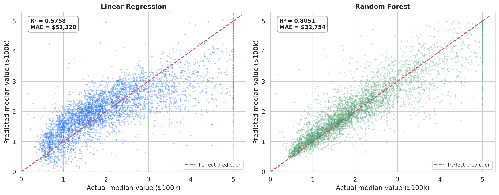
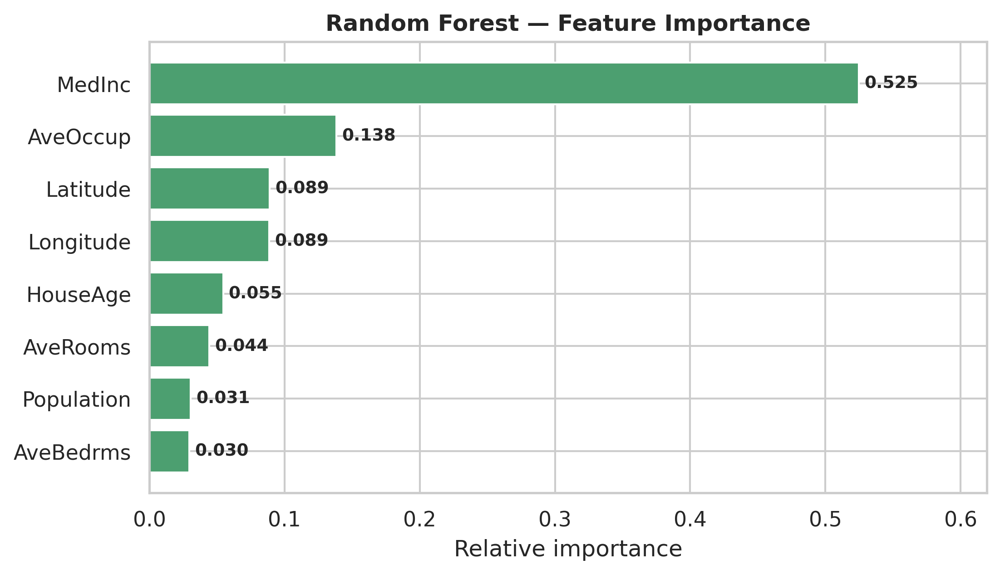
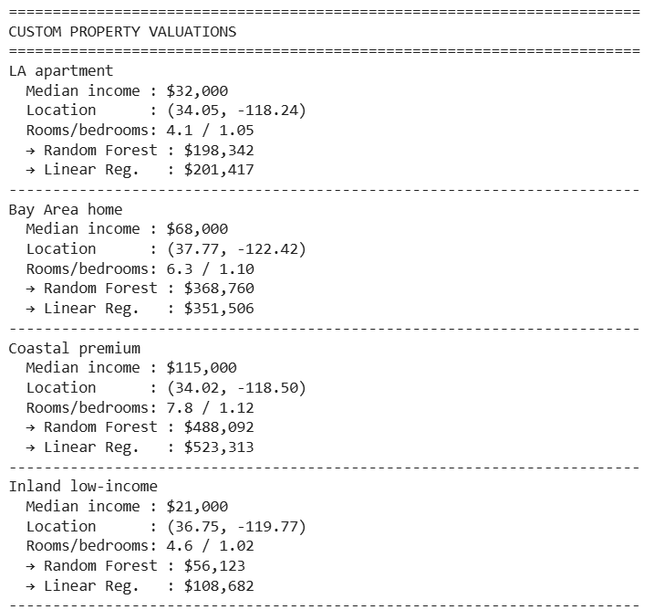

# Real Estate Property Price Predictor

> **Week 7 Milestone — 8-Week Practical Data Science Internship (GetIntern.in)**

A regression machine learning project that predicts continuous housing prices on the **California Housing** dataset using `scikit-learn`. It benchmarks a baseline **Linear Regression** model against an ensemble **Random Forest Regressor** on an 80/20 train-test split, inspects diagnostic plots and feature importances, and runs custom property valuations alongside an out-of-distribution stress test.

---

## Table of Contents
- [Project Objectives](#project-objectives)
- [Dataset Overview](#dataset-overview)
- [Methodology & Pipeline](#methodology--pipeline)
- [Model Performance Benchmark](#model-performance-benchmark)
- [Visual Diagnostics & Feature Importance](#visual-diagnostics--feature-importance)
- [Custom Property Price Inference](#custom-property-price-inference)
- [Out-of-Distribution Stress Test](#out-of-distribution-stress-test)
- [Repository Structure](#repository-structure)
- [How to Run](#how-to-run)

---

## Project Objectives
1. **Dual-Regressor Training:** Train both a `LinearRegression` baseline and an ensemble `RandomForestRegressor` (`n_estimators=100`, `random_state=42`) on an 80/20 train-test split.
2. **Regression Metric Benchmarking:** Compare linear vs. tree-ensemble performance using **MAE**, **RMSE**, and **R² Score** (plus train vs. test R² to inspect bias/variance trade-offs).
3. **Custom Property Inference Demo:** Score custom property feature profiles through the trained models and output clear USD price estimates.

---

## Dataset Overview
- **Source:** `sklearn.datasets.fetch_california_housing(as_frame=True)`
- **Size:** `20,640` census block-group records × `8` numeric features (`0` missing values, `0` duplicates)
- **Target (`MedHouseVal`):** Median house value in **$100,000s** (range: `0.15 – 5.00`, with `992` rows / `4.8%` capped at `5.00001`).

| Feature | Description |
| :--- | :--- |
| `MedInc` | Median income in block group (in $10,000 units) |
| `HouseAge` | Median house age in block group (years) |
| `AveRooms` | Average number of rooms per household |
| `AveBedrms` | Average number of bedrooms per household |
| `Population` | Block group population |
| `AveOccup` | Average number of household members |
| `Latitude` | Block group latitude |
| `Longitude` | Block group longitude |

---

## Methodology & Pipeline
1. **Leakage-Safe 80/20 Split:** `train_test_split(..., test_size=0.2, random_state=42)` creates `16,512` training samples (mean target: `$207,195`) and `4,128` test samples.
2. **Preprocessing:** `StandardScaler` is fitted **exclusively on `X_train`** and applied only to `LinearRegression`. `RandomForestRegressor` is trained directly on unscaled features so split thresholds and feature importances remain in original units.
3. **Model Serialization:** Trained artifacts (`random_forest_regressor.pkl`, `feature_scaler.pkl`, `feature_columns.pkl`) are exported with `joblib`.

---

## Model Performance Benchmark

Evaluated on the held-out **20% test set (`4,128` properties)**:

| Model | MAE ($100k) | MAE (USD) | RMSE ($100k) | Test R² | Train R² | Overfit Gap |
| :--- | :---: | :---: | :---: | :---: | :---: | :---: |
| **Linear Regression (Baseline)** | `0.5332` | `$53,320` | `0.7456` | `0.5758` | `0.6126` | `0.0368` |
| **Random Forest Regressor** | `0.3275` | `$32,754` | `0.5053` | `0.8051` | `0.9736` | `0.1685` |

### Key Takeaways
- **~39% Lower Error:** `RandomForestRegressor` reduces typical prediction error (MAE) from **$53,320** down to **$32,754** and increases explained variance (**R²**) from **0.5758** to **0.8051**.
- **Bias vs. Variance:** `LinearRegression` underfits (`Train R² = 0.6126` vs. `Test R² = 0.5758`) because housing prices depend on non-linear geographic interactions (`Latitude` × `Longitude`) and income thresholds. `RandomForestRegressor` (100 trees, mean depth `33.4`) captures these non-linearities while bagging keeps generalization strong.

---

## Visual Diagnostics & Feature Importance

### Predicted vs. Actual Values (Test Set)


### Random Forest Feature Importance


---

## Custom Property Price Inference

Using the `valuate()` helper (which enforces exact training column ordering and scales features automatically when scoring `LinearRegression`), four realistic California block-group property profiles were evaluated:

| Property Profile | MedInc ($10k) | Lat / Lon | Avg Rooms / Bedrms | Random Forest Estimate | Linear Regression Estimate |
| :--- | :---: | :---: | :---: | :---: | :---: |
| **LA apartment** | `3.2` ($32,000) | `(34.05, -118.24)` | `4.1 / 1.05` | **$198,342** | `$201,417` |
| **Bay Area home** | `6.8` ($68,000) | `(37.77, -122.42)` | `6.3 / 1.10` | **$368,760** | `$351,506` |
| **Coastal premium** | `11.5` ($115,000) | `(34.02, -118.50)` | `7.8 / 1.12` | **$488,092** | `$523,313` |
| **Inland low-income** | `2.1` ($21,000) | `(36.75, -119.77)` | `4.6 / 1.02` | **$56,123** | `$108,682` |

### Custom Property Prediction Output Screenshot


---

## Out-of-Distribution Stress Test

Because the California Housing dataset records **block-group household averages** (`AveBedrms` median: `1.05`, 95th percentile: `1.28`) rather than individual house bedroom counts, passing an individual home input like `AveBedrms = 3.0` (`0.51%` of training rows: `85 / 16,512`) triggers domain shift:
- **Linear Regression** extrapolates unboundedly (`$410,946`).
- **Random Forest** cannot extrapolate beyond training leaf averages (`$239,909`).

This highlights why production real estate pipelines require **input range validation** and **property-level listing data** when pricing individual homes by bedroom count and square footage.

---

## Repository Structure

```text
├── Week7_Real_Estate_Price_Predictor.ipynb   # Executed Google Colab notebook
├── README.md                                 # Project documentation & benchmarks
└── images/
    ├── predicted_vs_actual.png               # Dual-model predicted vs. actual scatter plots
    ├── feature_importance.png                # Random Forest feature importance chart
    └── custom_property_predictions.png       # Screenshot of custom property valuation output
```

---

## How to Run

1. Open `Week7_Real_Estate_Price_Predictor.ipynb` in [Google Colab](https://colab.research.google.com/) or JupyterLab.
2. Ensure the required libraries are available (`scikit-learn`, `pandas`, `numpy`, `matplotlib`, `seaborn`, `joblib`).
3. Click **Runtime → Run all** to reproduce all training metrics, diagnostic plots, and custom property valuations.
